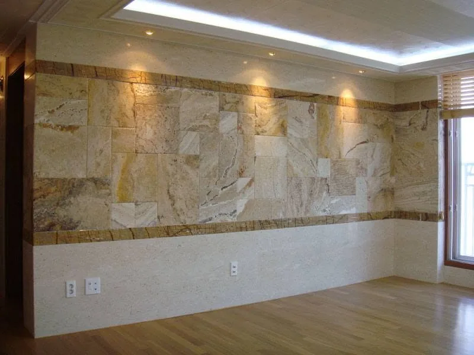

French Pattern este unul dintre cele mai recunoscute moduri de a așeza travertinul: mai multe dimensiuni de plăci, combinate într-un set care se repetă, dau pardoselii un aspect natural, aproape „de piatră de carieră", dar controlat. Îl găsești în terase, holuri și livinguri, dar și în placări de perete.

Mai jos explicăm ce înseamnă exact modelul, ce dimensiuni are un set, unde merită folosit și ce trebuie respectat la montaj. Am lucrat cu travertin French Pattern atât la interior, cât și la exterior, iar fotografiile din articol sunt din lucrări Stone Line.

## Ce este modelul French Pattern

French Pattern este un model modular: plăci dreptunghiulare și pătrate de mărimi diferite sunt așezate după o schemă care se repetă. Furnizorii îl numesc și **Versailles**, iar uneori **ashlar**. Se spune că numele Versailles trimite la pardoselile din palatul francez, dar sursele comerciale nu spun același lucru despre origine, așa că tratăm asta ca pe o poveste, nu ca pe un fapt.

Pentru tine contează un lucru practic: nu cumperi „plăci", ci **seturi**. Fiecare set conține piese de mărimi diferite, iar așezarea corectă ține cont de toate.

## Dimensiunile unui set

Setul clasic folosește patru formate, exprimate de obicei în țoli:

| Format (țoli) | Aproximativ în cm |
|---|---|
| 8 × 8 | 20 × 20 |
| 8 × 16 | 20 × 40 |
| 16 × 16 | 40 × 40 |
| 16 × 24 | 40 × 60 |

Un set de bază are 6 piese (1 × 16×24, 2 × 16×16, 1 × 8×16 și 2 × 8×8) și acoperă aproximativ **0,72–0,74 mp**. Unii furnizori vând pachete de două seturi (12 piese, ~1,5 mp), așa că verifică ce înseamnă „un set" în oferta pe care o primești. Modulele metrice diferă ușor de la un producător la altul (de exemplu 40,6 × 61 cm), de aceea confirmăm dimensiunile exacte pe fiecare lot, în fișa tehnică.

Fiindcă piesele se vând pe seturi întregi, cantitatea se rotunjește în sus. Rezerva pentru tăieri se stabilește pe plan, așa că cere o ofertă pe măsurători (vezi și [cât costă piatra naturală](/blog/cat-costa-piatra-naturala-2026/)).

## Finisaje potrivite

La travertin, aspectul se schimbă mult în funcție de finisaj:

- **Antichizat (tumbled):** muchii rotunjite, aspect „vechi" elegant. Este alegerea clasică pentru terase și pentru stilul mediteranean.
- **Periat:** mat și soft, potrivit pentru pardoseli interioare moderne.
- **Natural / scapițat:** textură rustică, bună pentru accente și placări.
- **Umplut sau neumplut:** porii pot fi umpluți cu rășină sau ciment (suprafață mai netedă, mai ușor de curățat) sau lăsați deschiși (aspect mai brut). Detalii în [ghidul complet de travertin](/blog/travertin-ghid-complet/).

## Unde se folosește

**Interior:** holuri, livinguri, spații cu trafic moderat și placări de perete. Fotografia de mai jos arată o placare interioară din travertin French Pattern, cu benzi decorative de piatră.

<figure>

<figcaption>Placare interioară din travertin French Pattern — lucrare Stone Line.</figcaption>
</figure>

**Exterior, cu condiții stricte:** terase și alei pietonale. Travertinul este poros, așa că la exterior are nevoie de:

1. pantă de scurgere de minimum 1–2%, ca apa să nu băltească;
2. hidroizolația suportului, unde e cazul (terase, balcoane);
3. impermeabilizare imediat după montaj și reînnoire periodică — vezi [impermeabilizantul cu aspect natural sau umed](/blog/impermeabilizant-piatra-naturala-aspect-natural-umed/);
4. atenție la gheață: o prezentare tehnică depusă la comisia de monumente din New York, privind dalajul unei piețe exterioare, citează recomandarea Marble Institute of America împotriva travertinului la exterior, în locurile unde se folosesc săruri de deszăpezire. Am detaliat în articolul despre [sarea de deszăpezire și piatra naturală](/blog/sare-deszapezire-piatra-naturala/).

În zonele cu ierni grele sau cu trafic intens, [andezitul](/andezit.html) sau granitul rămân alegerile mai sigure.

## Montaj: ce contează la un model modular

Regulile generale de montaj sunt aceleași ca la orice piatră naturală ([vezi ghidul de montaj](/blog/montaj-piatra-naturala/)): suport stabil și uscat, adeziv flexibil pentru piatră naturală, rosturi de dilatare, hidroizolație acolo unde e nevoie. La French Pattern se adaugă câteva lucruri:

- **Pornești de la o linie de referință**, de obicei de la un perete drept sau dintr-un colț, și verifici schema pe câteva rânduri înainte de a lipi.
- **Amesteci piesele din mai multe cutii.** Travertinul variază în culoare și în vene, iar un set așezat „la grămadă" din aceeași cutie se vede.
- **Planifici tăierile la margini.** Modelul cere mai multe tăieri decât un format unic, de aceea cantitatea se calculează pe plan, nu după suprafață.
- **Rostuiești cu chit flexibil**, potrivit pentru interior sau exterior.

Un model cu mai multe formate cere de regulă mai multă muncă de așezare și tăiere, deci montajul poate costa mai mult decât la plăci de format unic. Confirmăm asta în oferta pe măsurători.

## Costuri orientative

Intervalele de mai jos sunt cele din [ghidul nostru de prețuri 2026](/blog/cat-costa-piatra-naturala-2026/) și sunt orientative. Nu conțin particularitățile unui model modular și nu înlocuiesc o ofertă.

| Element | Interval orientativ |
|---|---|
| Travertin (material + prelucrare) | 300–650 lei/mp |
| Montaj pardoseală interioară | 90–180 lei/mp |
| Montaj terasă / pavaj | 120–225 lei/mp |
| Montaj fațadă / soclu (lipire) | 150–300 lei/mp |

Pregătirea suportului, hidroizolația, impermeabilizarea și transportul se adaugă separat.

## Întrebări frecvente

**Este French Pattern același lucru cu Versailles?**
În practică, da. Furnizorii folosesc ambele nume pentru același tip de set modular, iar uneori și denumirea „ashlar". Verifică dimensiunile din ofertă, nu doar numele.

**Câte piese are un set?**
Depinde de furnizor. Setul de bază are 6 piese și acoperă ~0,72–0,74 mp, dar se vând și pachete de două seturi. Cere să ți se spună exact ce include prețul.

**Se poate monta French Pattern pe terasă în România?**
Da, cu pantă corectă, hidroizolație, impermeabilizare și reînnoirea tratamentului. Fără aceste condiții, riscul de degradare la îngheț este ridicat.

**Merge pe încălzire în pardoseală?**
Da, cu adeziv și sistem compatibile. Am explicat condițiile în articolul despre [piatra naturală pe încălzire în pardoseală](/blog/piatra-naturala-incalzire-in-pardoseala/).

**Pot vedea piatra înainte să comand?**
Da, în showroom-ul din Cristești, Mureș. Înainte de debitare îți trimitem și fotografia lastrei exacte din care se face lucrarea.

---

Travertinul French Pattern merită atunci când vrei aspect cald și natural și ești dispus să respecți regulile de montaj și întreținere. Dacă ai un proiect, trimite-ne planul sau câteva fotografii pe WhatsApp, sau cere o [consultanță gratuită](/consultanta.html).
